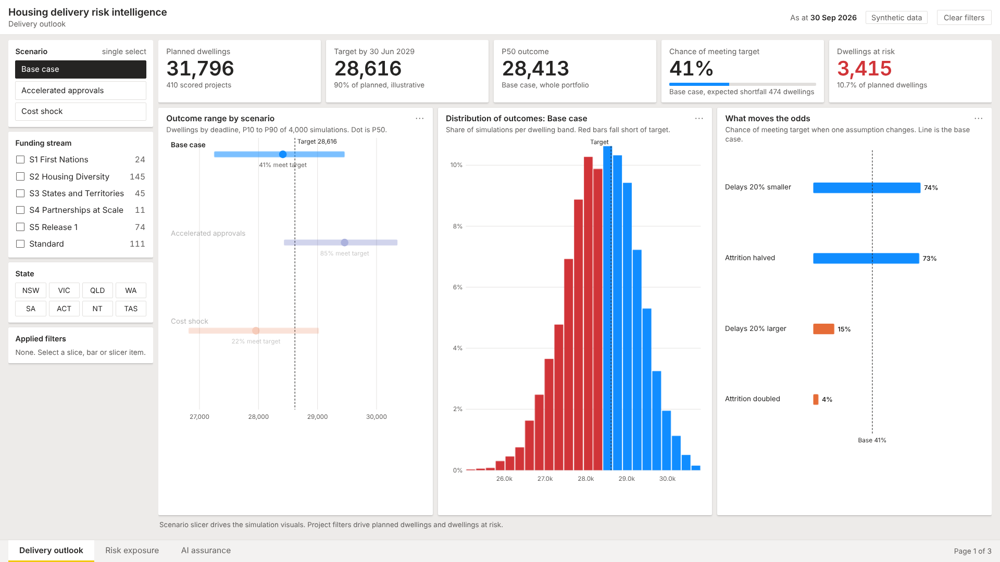
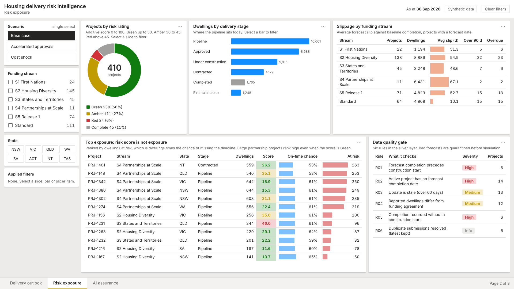
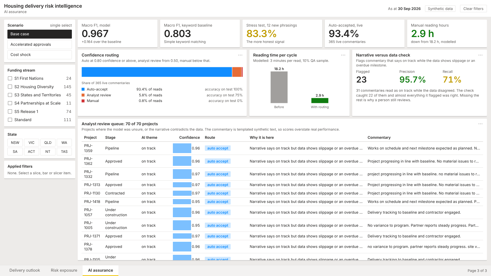

# Housing Delivery Risk Intelligence

End-to-end reference project: data pipeline, data quality gate, risk scoring, Monte Carlo delivery forecast, AI-assisted commentary assurance, Power BI measures, CI, and a hosted dashboard. All data is synthetic and illustrative.

## Run it
```
pip install -r requirements.txt
python src/generate_data.py
python src/pipeline.py        # bronze, silver, gold, reconciliation
python src/forecast.py        # risk scores, scenarios, sensitivities
python src/ai_assurance.py    # tagger, routing, audit log
python -m pytest -q tests
```
Outputs land in `outputs/`.


## Report
A three-page, Power BI-style report built as one standalone HTML file with no dependencies. Every number comes from the pipeline outputs in this repo.

- **Delivery outlook:** chance of meeting the target, dwellings at risk, scenario slicer (base case, accelerated approvals, cost shock) and sensitivity to attrition and delay assumptions.
- **Risk exposure:** projects ranked by dwellings at risk rather than risk score, with cross-filtering by rating, stage and funding stream.
- **AI assurance:** confidence routing of partner commentary, the narrative-versus-data check, and the analyst review queue.

Open the live report: https://kriti-data-business.github.io/Housing-delivery-risk-intelligence-reporting-live-ai/
Or open `docs/index.html` in any browser. Rebuild it with `python report/build.py`.





## Layout
- `src/` generator, pipeline, forecast, AI module
- `sql/` silver, gold, views
- `tests/` 15 tests
- `dax/measures.dax` Power BI measures (not tested in Power BI)
- `report/` report template, data and build script; output is `docs/index.html`
- `docs/` case study, architecture, data dictionary, AI adoption plan, deployment runbook
- `.github/workflows/ci.yml` build and test

## Limits
Synthetic data. Risk weights and the 90% target are assumptions. AI metrics are inflated by templated text. Fabric and Power BI deployment are documented, not executed.
